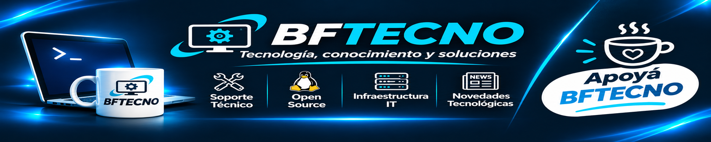

  

# 💻 BFTECNO

### 🚀 Tecnología, conocimiento y soluciones

**Soporte Técnico • Open Source • Infraestructura IT • Novedades**

---

## 👋 ¡Hola! Soy Ariel Canteros

Soy un apasionado de la tecnología, con muchos años de experiencia en **soporte técnico e infraestructura IT**.

A lo largo de mi trayectoria fui adquiriendo conocimientos, descubriendo herramientas y resolviendo desafíos informáticos.

Así nació **BFTECNO**, un espacio creado para compartir experiencias, soluciones y recursos que puedan ayudar a otras personas.

## 📚 ¿Qué vas a encontrar?

- 🛠️ **Soporte técnico:** Tips, tutoriales y soluciones informáticas.
- 🐧 **Open Source:** Programas gratuitos y herramientas recomendadas.
- 🖥️ **Infraestructura IT:** Linux, Windows, redes, servidores y virtualización.
- 📰 **Novedades tecnológicas:** Noticias, actualizaciones y tendencias.

## 🤝 Compartamos conocimiento

Creo que **el conocimiento crece cuando se comparte**.

Si conocés alguna herramienta interesante, tenés un tip o querés aportar tu experiencia, ¡tu colaboración es bienvenida!

## ☕ Apoyá BFTECNO

Todo el contenido es gratuito y está pensado para ayudar a la comunidad.

Si te resulta útil y querés colaborar para que este proyecto siga creciendo, podés hacerlo con una donación voluntaria.

**¡Gracias por apoyar este proyecto! 💙**

---

### 💙 BFTECNO
**Tecnología para todos.**

*Creado por Ariel Canteros*

⭐ Si te gusta el contenido, seguí el proyecto.

